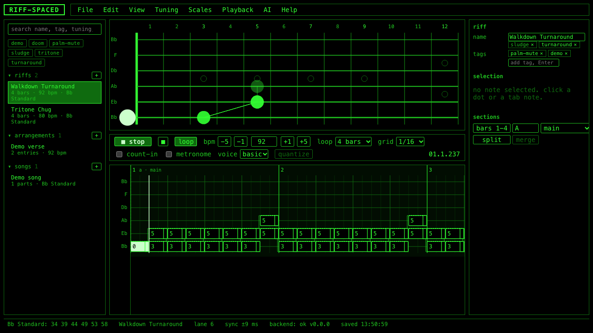

# RIFF-SPACED



A browser-based guitar riff-writing and transposing tool for heavy, low-tuned, chromatic riff music: sludge, doom, and power metal with a blues-turnaround feel. You see a guitar neck in any tuning (Bb Standard by default), enter and arrange riffs built from dyads and power chords on the low strings, hear them back with the fretboard flashing each note in sync, and save, load, and export them as JSON, MIDI, text tab, MusicXML, and WAV. A Python backend turns recordings of your own playing into riff JSON laid out the way you actually fret it, and an AI layer that is given the owner's style directive verbatim names the dyads, reads the style, and suggests counter riffs, variations, fingerings, and tunings.

Built in public with Claude Code, phase by phase from a written spec. Every commit explains WHY it was made, WHAT changed, what a newcomer can LEARN from it, and how it was TESTed.

- **Live demo (frontend only):** https://spaced-lab.github.io/Riff-SPACED/?demo=1
- **Where things stand:** [STATUS.md](STATUS.md)
- **User guide:** [docs/USER_GUIDE.md](docs/USER_GUIDE.md)
- **Contributing:** [docs/CONTRIBUTING.md](docs/CONTRIBUTING.md)
- **Read the commits in order:** [docs/LEARNING_LOG.md](docs/LEARNING_LOG.md)

## Features

- Fretboard in any tuning, 6 to 8 strings, standard and drop presets, custom retune per string, note letters or dots, realistic or even fret spacing, 0 to 12 or 0 to 24 frets.
- Tab lanes with a 480 ticks-per-quarter grid, sections, loop lengths of 4, 8, 12 or 16 bars, marquee selection, drag, resize, clipboard, quantize, undo and redo, autosave.
- Dyads as first-class objects: two notes that start together are labeled P5, P4 (inverted, root on top), m3, TT and so on, in the inspector and above the tab.
- Playback through Web Audio with a lookahead scheduler: loop, count-in, metronome, section solo, a basic and a heavy (tanh-driven) voice, a four-way split view that follows the loop.
- Transpose by semitones and retune keeping shapes or keeping pitches, with unreachable notes flagged amber and never dropped; a search for easier tunings with the refingered riff ready to preview and apply.
- Library of riffs, arrangements and songs; open and save through the File System Access API with download fallbacks; export library, text tab, MIDI (optionally one channel per string), MusicXML with a TAB staff, and a rendered WAV.
- Audio import: a numpy and scipy pipeline (onsets, tempo, fingering-constrained spectral template matching, Viterbi decoding, quantization) that writes riff JSON with a confidence per note, from the CLI or the import dialog.
- AI layer on the Claude API: analyze a riff, suggest variations, counter riffs, simplifications, embellishments, fingerings and tunings, clean up imports within strict bounds; every answer validated, repaired and traceable to the prompt version; audition before accepting, and every accept is one undo step. Runs on a deterministic fake client without a key.

## Quick start

Frontend only (everything but audio import and the AI menu):

```
cd frontend
npm install
npm run dev          # http://localhost:5173
```

With the backend:

```
cd backend
make install         # uv sync --extra dev (or pip install -e ".[dev]")
make dev             # http://localhost:8000/health, /docs
# optional: RIFFSPACED_AI_FAKE=1 make dev   tries the AI menu on the fake client
# optional: put ANTHROPIC_API_KEY=... in backend/.env for the real model
```

With Docker (the whole app on one origin):

```
make up              # docker compose up --build -d: http://localhost:8080
make down
```

Everything the owner needs to run or resume the project, including the checks, is in [STATUS.md](STATUS.md).

## Learn from the commits

Every commit message has four parts, so `git log` reads as a course:

```
<type>(<scope>): <summary>

WHY: the motivation in a sentence or two.
WHAT:
- concrete change
LEARN: the concept, the trap, or the pattern a newcomer could take away.
TEST: how it was verified.
```

Useful views:

```
git log --format='%h %s'                              # the table of contents
git log --format='%h %s%n%n%b' -- backend/riffspaced/analysis   # one subsystem's story
git log --grep='LEARN:' --format='%h %s%n%b' | grep -A3 'LEARN:'   # just the lessons
git show 9e44b16                                      # a parameter sweep written into history
```

[docs/LEARNING_LOG.md](docs/LEARNING_LOG.md) starts with a reading order of the fifteen most instructive commits, then one entry per phase. [DECISIONS.md](DECISIONS.md) holds every pre-made decision and every one made during the run, numbered.

## Architecture

```
  browser (React + TypeScript, Vite)                     Python 3.12 (FastAPI)
  +-----------------------------------------+           +--------------------------------+
  | music/   pitch, tuning, time, dyad,     |  shared/  | music/     the same rules,     |
  |          fingering, transpose, search   | <-------> |            tested on the same  |
  | model/   types, validation, migration   |  schemas  |            fixture             |
  | store/   zustand slices, one commit()   |  fixtures | model/     validation, migrate |
  | audio/   scheduler, voices, render      |           | analysis/  io, stft, onsets,   |
  | export/  text tab, MIDI, MusicXML, WAV  |           |            tempo, matching,    |
  | storage/ pickers, autosave, merging     |  HTTP     |            decode, quantize    |
  | api/     /health /analyze /ai/*         | --------> | ai/        prompts, client,    |
  | fretboard/ tab/ inspector/ library/ ai/ |           |            analyze, suggest,   |
  +-----------------------------------------+           |            cleanup, fake       |
                                                        +--------------------------------+
                                                                      |
                                                            Claude API (optional)
```

The two `music/` folders implement the same rules and are tested against one fixture, `shared/fixtures/music-conventions.json`, so the browser and the analyzer cannot disagree about what a note, a tuning or a dyad is.

## Documentation

- [docs/USER_GUIDE.md](docs/USER_GUIDE.md): for guitarists.
- [docs/CONTRIBUTING.md](docs/CONTRIBUTING.md): setup, gates, commit format, how to add things.
- [docs/MUSIC_MODEL.md](docs/MUSIC_MODEL.md): pitches, strings, ticks, dyads, fingerings, transpose, the easier-tuning search.
- [docs/FRETBOARD.md](docs/FRETBOARD.md) and [docs/EDITOR.md](docs/EDITOR.md): the neck, the tab lanes, the editor's state machine, shortcuts.
- [docs/AUDIO_ENGINE.md](docs/AUDIO_ENGINE.md): the scheduler, the voices, offline rendering.
- [docs/FILE_FORMATS.md](docs/FILE_FORMATS.md): riff, arrangement, song and library JSON, text tab, MIDI, MusicXML.
- [docs/ANALYSIS_METHOD.md](docs/ANALYSIS_METHOD.md) and [docs/benchmarks/](docs/benchmarks/): how recordings become riffs, with the numbers.
- [docs/AI_LAYER.md](docs/AI_LAYER.md): the prompts, the JSON contract, the repair rules, the worked example.
- [outboard-guidance/](outboard-guidance/): a guide for other tools or models that transcribe a recording into our JSON.
- [SPEC.md](SPEC.md), [PLAN.md](PLAN.md), [plan/](plan/): what was built from.

## Roadmap

From [docs/BACKLOG.md](docs/BACKLOG.md): the real-recording pass (run the owner's takes through the analyzer until notes can be picked out, then emit YAML), the live AI smoke test once a key exists, the cleanup pass in the import dialog, a keyboard-only Tab order, dyad naming modes, odd meters and tempo maps, practice loops with speed ramps, riff history, PDF export, sample-based voices, MIDI input, a mobile layout.

## License

MIT, see [LICENSE](LICENSE). 2026 Ridley DiSiena (SPACED).
