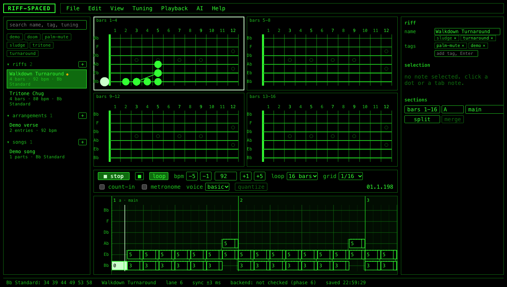

# The audio engine

How RIFF-SPACED turns a riff into sound and keeps the picture in time with it (Phase 4). Everything lives in `frontend/src/audio/` and imports no React.



## The two-clocks problem

A browser has two clocks and they do not agree. `setTimeout` and `setInterval` run on the main thread: they are late by whatever the page is doing, often by tens of milliseconds, and they jitter. `AudioContext.currentTime` is the audio hardware's clock: exact and steady, but it cannot call your code. Scheduling notes with timers sounds drunk; scheduling them on the audio clock requires knowing about them in advance.

The lookahead scheduler is the standard answer, and the thing worth learning here:

```
 main thread (jittery)                       audio thread (exact)
 ───────────────────────                     ────────────────────
 every 25 ms: wake up                        plays each node at the
   look 100 ms ahead                         time it was told, no
   for every event in that window:           matter what the main
     tell a node to start/stop at            thread is doing
     its exact audio time ──────────────▶
```

`scheduler.ts` wakes up every 25 ms (`INTERVAL_MS`) and hands the audio clock every event whose time falls within the next 100 ms (`LOOKAHEAD_SECONDS`). As long as a wake-up never slips by more than 75 ms, the audio clock never runs dry. The clock and the timer are injected (`SchedulerClock`), which is why the same scheduler runs under a fake clock in tests and under a hand-driven clock for offline rendering.

## Absolute ticks and the loop

The scheduler counts in absolute ticks, a number that never resets. A 4-bar loop is 7680 ticks long; absolute tick 7680 is loop tick 0 of pass 2. `TempoClock` maps absolute ticks to seconds (`time = origin + ticks * secondsPerTick`) and back. Because the count never wraps, the first notes of pass 2 are scheduled while pass 1 is still sounding; nothing is reset at the loop point and there is no gap. Changing tempo mid-play rebinds the clock at the current absolute tick, so position is preserved and only the mapping changes.

Edits while playing swap the note list in place. The scheduler keeps a set of `pass:noteId` keys for everything it has already handed out, rewinds its cursor to the current position, and walks forward again: a note added just ahead of the playhead sounds this pass, and nothing sounds twice.

## Why visuals read the audio clock

Every noteOn and noteOff the scheduler emits also goes into a visual queue tagged with its audio time. A `requestAnimationFrame` loop in `engine.ts` drains that queue each frame against `audioContext.currentTime`, applying everything whose time has passed and nothing else. The picture is therefore late by at most one frame (16 ms) and never early. The status bar shows the measured gap as `sync ±N ms` (about 3 to 9 ms on this machine). Two details keep this cheap: the sounding set is written to the store once per frame and skipped when unchanged, and the playhead line is moved by writing its x attribute directly through `tab/playheadRef.ts` instead of re-rendering React sixty times a second.

## The engine

`Engine` binds the pieces and watches the store:

- `isPlaying` flips to true: create the AudioContext if needed (this happens inside the click, which is what browsers require), resume it, build a `Playable` from the riff (the solo section, if any, becomes the loop window), and start the scheduler from the edit cursor with the chosen voice, loop, count-in and metronome settings.
- `isPlaying` flips to false: stop everything, clear highlights, put the playhead back at the edit cursor.
- Riff notes change while playing: `setPlayable`. Tempo changes: `setTempo`. Solo or voice changes: restart at the current position without a count-in.
- A non-looping pass ends: the scheduler stops itself after the last note off and the engine flips `isPlaying` back.

The transport never touches audio. It only sets store fields, which is why it renders and tests without an AudioContext, and why the keyboard (Space, L, minus and equals) is three lines of store calls.

## The voice graph

```
 basic voice, per note                         master bus, shared
 ─────────────────────                         ───────────────────
 saw(f) ─────────┐                             gain 0.5 ─▶ compressor ─▶ out
 square(f, +4c) ─┤ gain 0.5 ─▶ lowpass ─▶ ADSR ─▶ (-12 dB, 4:1)
                 │            2.5 kHz Q1   gain
 dead: 40 ms noise ─▶ bandpass 180 Hz ─▶ gain
```

The envelope is scheduled in one go at noteOn (attack 3 ms, decay 150 ms to 0.6, hold, release 60 ms) because the scheduler already knows how long the note lasts. `palmMute` makes it short and dark (decay 90 ms to silence, release 30 ms, cutoff 1.2 kHz); `letRing` stretches the release to 400 ms; `dead` replaces the oscillators with a noise thud. Velocity scales the peak from 0.25 to 1.0. The master caps polyphony at 12 and steals the oldest note.

The heavy voice (the Phase 4 stretch item) adds a sine sub oscillator an octave down at 0.4 and sends everything through one shared `tanh(6x)` waveshaper, a 4 kHz lowpass and a 70 Hz highpass: one crude amp for all strings. Samples and a real amp simulation are backlog.

## Offline rendering

`render.ts` runs the same scheduler and voices into an `OfflineAudioContext` with a clock the renderer advances itself, then encodes 16-bit PCM WAV with the 44-byte header written by hand in `export/wav.ts`. Phase 8 wires it to File > Export > WAV. Today its job is the e2e test `render.spec.ts`: render the demo walkdown, check the RMS, the peak, and that the first attack lands within 20 ms of the scheduled start. It is how CI hears.

## Numbers worth knowing

| Setting | Value | Where |
|---|---|---|
| timer interval | 25 ms | `INTERVAL_MS` |
| lookahead | 100 ms | `LOOKAHEAD_SECONDS` |
| start delay | 50 ms | `START_DELAY_SECONDS` |
| position readout | 30 updates/s | `POSITION_UPDATES_PER_SECOND` |
| polyphony | 12 | `POLYPHONY` |
| measured visual jitter | 3 to 9 ms | status bar |
