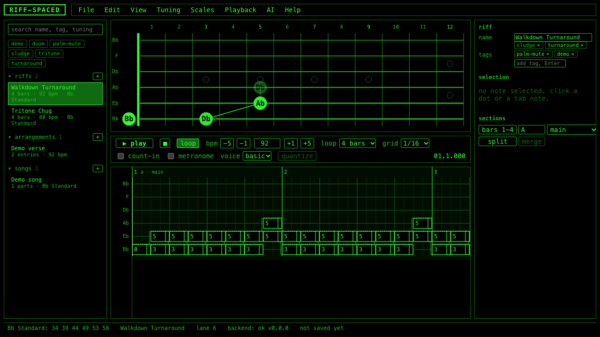
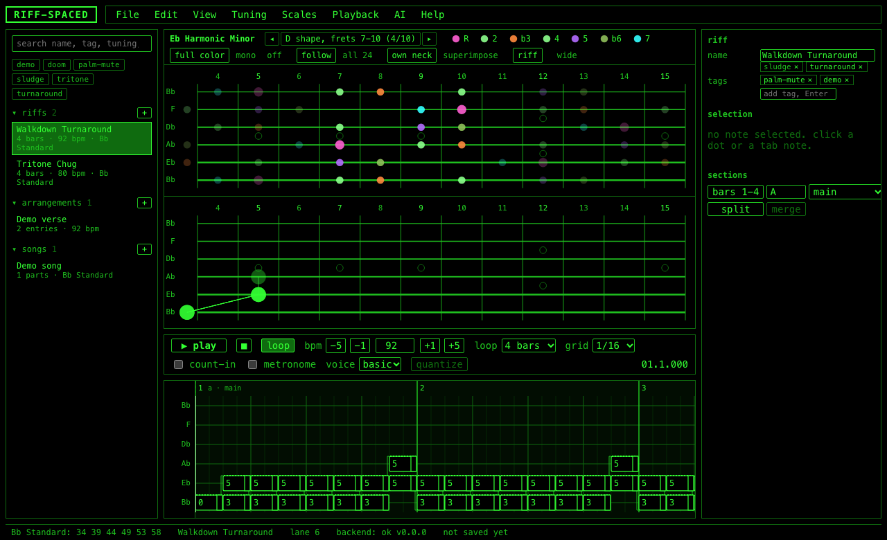
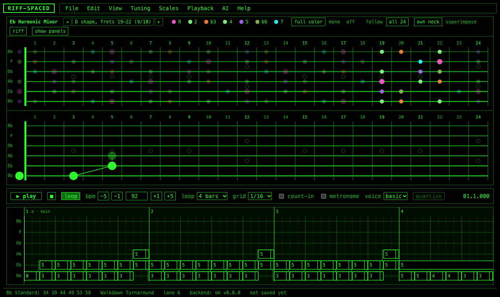

# The fretboard

How the SVG fretboard in `frontend/src/fretboard/` maps strings and frets to pixels, why it is SVG, and how a dot decides what it looks like.

## Why SVG

The fretboard is a drawing of a few hundred simple shapes: lines for wires and strings, circles for markers and notes, text for numbers and letters. SVG fits that exactly. Every element is a DOM node, so it can be inspected in devtools, found by a test (`[data-note-id]`, `[data-cell]`), styled by the theme file, and given its own click handler. It stays crisp at any zoom. Canvas would be faster for thousands of moving shapes, but nothing here moves except the sounding dots, and they are a handful.

The one performance rule, which matters more in the tab lanes than here, is that the playhead is moved by writing to a ref each animation frame rather than re-rendering React. The fretboard itself only re-renders when the set of notes, the selection, or the highlighted set changes, and the store skips highlight updates when the set is unchanged.

## Geometry

`geometry.ts` is a pure function from a pixel box to coordinates. Given a width, a height, a fret range, a string count, and whether spacing is realistic, `layout()` returns:

- `fretX(fret)`: the x of a fret wire. Even spacing divides the neck width by the number of frets in range. Realistic spacing uses the real-neck rule, each fret 2^(-1/12) = 0.944 of the previous one, with the distances normalized so the requested range still fills the width.
- `noteX(fret)`: the center of the space ending at that wire. The open string sits just left of the nut, at `nutX - 1.4 * dotRadius`.
- `stringY(string)`: string 1 at the top, string N at the bottom, equal gaps. This matches printed tab and the tab lanes below the fretboard.
- `dotRadius`: `min(0.42 * stringGap, 0.38 * narrowestFret)`, never below 3 px, so dots fit both the string spacing and the narrowest fret in a realistic 0-24 view.
- `markers`: the frets with position dots (3, 5, 7, 9, 15, 17, 19, 21 single; 12 and 24 double), only those inside the range.

The component measures its container with a `ResizeObserver` and passes the size in, so the same math serves the main view, the four-way split, and the small previews on AI suggestion cards.

## Layers, bottom to top

1. Fret numbers above the neck (marker frets brighter).
2. Position markers between the wires.
3. Fret wires; the nut is a thicker bright line when the range starts at 0.
4. Strings, thicker toward the low side, with the open-string names in the left gutter.
5. One transparent hit rectangle per (string, fret) cell. This is what makes empty neck clickable: SVG lines are one pixel wide, rectangles are not.
6. Scale dots (Phase 9), when a scale is shown: one small dot on every cell whose pitch class is in the scale, colored by degree. They ignore the pointer, so the cells under them stay clickable. See "The scale overlay" below.
7. Chord connectors: a thin line between notes that share a `chordId`, the fingering hint for a dyad.
8. Note dots, last so they sit on top and receive clicks first. A dot stops propagation so clicking a note is never also a click on its cell.

## The dot state machine

A dot is a `<g>` with a circle and an optional letter. Its appearance is a set of CSS classes, decided in `FretboardNote.tsx` and styled only in `fretboard.css`:

| Class | When | Look |
|---|---|---|
| (none) | a normal note | green fill |
| `fb-note--selected` | in the selection | green fill, white outline |
| `fb-note--sounding` | in `highlightIds` during playback | bright fill, scaled 1.25 for 80 ms |
| `fb-note--low` | `confidence` below 0.6 (audio import) | amber fill |
| `fb-note--unplayable` | flagged by transpose or retune | hollow amber outline |
| `fb-note--dimmed` | ghost context (other notes in the bar) | 35 percent opacity |

States combine: a selected, sounding note has both classes. Because the component never names a color, the CRT toggle in Phase 8 and any future theme restyle every state from one file.

Letters are drawn in black inside the dot using `nameOf(pitch, accidentals, false)`, so the flats and sharps toggle changes them with no component logic.

## The scale overlay (Phase 9)

`music/scales.ts` holds eight scales as tables of degrees. A degree is an interval above the root plus the role it plays (root, third, fifth...) and whether it is lowered against the major scale, so b3 and 3 can look different. `degreesOf(scale, root)` turns that into a 12-entry table indexed by pitch class; the fretboard looks up `pitchClass(pitchOf(tuning, string, fret))` for every cell and draws a dot where the entry is not null. The scale itself never knows about strings or frets, which is why it works in any tuning.

Colors are a table, not code. Each degree has a CSS class (`fb-scale--third-flat`) and each class one token in `theme.css` (`--scale-third-flat`). The legend above the neck draws its swatches with the same classes, so legend and neck cannot disagree. Change a color by editing the token.

| Degree | Class | Default color |
|---|---|---|
| R | `root` | pink |
| 2 | `second` | pale green |
| b3 / 3 | `third-flat` / `third` | orange / gold |
| 4 | `fourth` | pale green |
| b5 (blues) | `blue` | blue |
| 5 | `fifth` | purple |
| b6 / 6 | `sixth-flat` / `sixth` | olive / lime |
| b7 / 7 | `seventh-flat` / `seventh` | teal / cyan |

Three modes: off, full color, and mono (every scale note the same plain ring). In full color each degree group (roots, thirds, fifths, sevenths, blue notes, others) has a switch; a group switched off is drawn as the plain ring, not hidden, so you can see only the roots in color while the rest of the scale stays as context. The root follows the lowest open string until you choose one.

**Hand positions (CAGED).** `music/positions.ts` cuts the scale into the shapes a hand plays without moving. The derivation: every pentatonic box has two notes per string, and the box anchored at the k-th pentatonic note on the lowest string takes, on every other string, the consecutive pair whose lower note is nearest in fret to that anchor. Seven-note scales use the same boxes built from their pentatonic skeleton (major pentatonic when the scale has a natural third, minor pentatonic otherwise), then add the remaining scale notes inside the box's fret span. That reproduces the five classic pentatonic boxes exactly, and for a major scale gives the usual CAGED positions with two or three notes per string. Positions are named E, D, C, A, G going up the neck (the E shape is the box whose low-string pair starts on the root) when the tuning has standard intervals; other tunings get Position 1, 2, 3. With a position selected, scale dots outside it are dimmed and riff notes are untouched. Step with `<` and `>`, the arrows in the legend, or Scales > Position.

Choosing a position also slides the fret range (`rangeCenteredOn` in the view slice): same width, centered on the shape, clamped to 0..24, so the board follows the hand up the neck. That is the `follow` neck option; `all` pins the range to 0-24 so every shape is on screen and the dots shrink to fit (`scaleNeck` in the scale slice, persisted).

**Two necks or one.** `scaleLayout` (scale slice, persisted) is `separate` by default: the shell renders a second `Fretboard` above the riff neck with `notes={[]}` and the overlay, and the riff neck without the overlay, so nothing is drawn over anything; `scaleShowRiff` leaves the riff neck out entirely. `superimpose` is the single-neck form: the overlay goes under the riff notes and the notes get `fb-note--outline` (a ring in the foreground color, no fill), so the scale dot inside each ring stays readable. Split view follows the same rule: overlay in every quadrant only when superimposed.

**Wide fretboard.** `wideBoard` in the view slice leaves the library and inspector panels out of the shell so the center column, and the board with it, takes the full width at the same height. The geometry is ready for any board size: the gutter left of the nut grows with the dot radius so the open-string dot and its label stay inside the SVG, the fret-number baseline is clamped inside the top padding, label font size follows the dot size (11 to 20 px), and scale dots carry their note letter once their radius reaches 8 px.

## Interaction surface

Everything leaves the component as a callback: `onCellClick({ string, fret, shiftKey })` from the hit rectangles, `onNoteClick(id, { shiftKey, button })` and `onNoteContextMenu(id)` from the dots. The store decides what those mean (Phase 3: add a note at the edit cursor, add to the chord with shift, select, delete). Hovering any cell or dot shows `string 6 fret 3 = Db2`, and with a scale shown, `, b3 of Bb Minor Pentatonic`.

## Trying it

The harness at `/#/dev/fretboard` shows four boards at once: Bb Standard with dots, the same with letters, E Standard 0-24 with realistic spacing and sharps, and a seven-string B Standard. The Playwright spec `e2e/fretboard.spec.ts` screenshots each one into `docs/screenshots/phase-02/`.
