# RIFF-SPACED user guide

## 1. What this is

RIFF-SPACED is a riff editor that runs in your browser. You see a guitar neck in any tuning, put notes on it, hear them back with the fretboard lighting up in time, and save or export what you wrote. It is built for heavy, low-tuned, chromatic playing: dyads and power chords on the low strings, palm muting, the blues turnaround played as sludge. The default tuning is Bb Standard (Bb1 Eb2 Ab2 Db3 F3 Bb3) and the whole thing is drawn in terminal green on black, monospace, with an optional CRT scanline look.


## 2. Getting it running

Three ways, from least to most setup.

**Just open it.** https://spaced-lab.github.io/Riff-SPACED/?demo=1 is the frontend on GitHub Pages. Everything that does not need the backend works there: writing, playback, tunings, transpose, saving to the browser, every export. `?demo=1` loads the two demo riffs; drop it from the address to keep what you had.

**Run the frontend locally.**

```
cd frontend && npm install && npm run dev      # http://localhost:5173
```

**Run the backend too.** Two features need it: File > Import from audio, and the AI menu.

```
cd backend && make install && make dev         # http://localhost:8000
```

Or, with Docker, `make up` at the repo root builds both and serves the app on http://localhost:8080 (the backend is also on 8000). `make down` stops it.

The AI menu additionally needs an API key in `ANTHROPIC_API_KEY` or `backend/.env`. Without one, put `RIFFSPACED_AI_FAKE=1` in the environment to try the menu on a built-in fake that returns plausible answers (see section 9). The frontend polls the backend every 15 seconds and the status bar says whether it is reachable.

## 3. The screen


**Menu bar.** File, Edit, View, Tuning, Playback, AI, Help. Items that cannot run right now are grayed with the reason as a tooltip (for example `backend unreachable at http://localhost:8000`, or `open a riff first`).

**Library (left).** Your riffs, arrangements and songs, in three collapsible groups, with a search box and tag chips. The current item is highlighted, riffs with unsaved edits get a dot. Right-click an item for open, duplicate, rename, delete. View > Library panel hides it.

**Fretboard.** Nut on the left, low string at the bottom, fret numbers above. It shows what sounds at the edit cursor, with the rest of the current bar drawn dim (View > Ghost notes). Hover any spot to read `string 6 fret 3 = Db2`. View > Fret range picks 0-12, 0-24, 0-5 or 5-17; View > Realistic fret spacing narrows the frets like a real neck.

**Transport.** Play/stop, stop and reset, loop, bpm with -5 -1 +1 +5 buttons, loop length (4, 8, 12, 16 bars), grid, count-in, metronome, voice, quantize, the position readout as `bar.beat.tick`, and a `solo <section>` button when a section is soloed.

**Tab lanes.** One lane per string, string 1 on top, time left to right. Each note is a box with its fret number; palm-muted notes have a dotted top edge; a thin bracket joins the notes of a chord. The dashed line is the edit cursor, the bright line is the playhead. Scroll with the wheel, zoom with Ctrl/Cmd + wheel.

**Inspector (right).** The riff name and tags, the selected notes (position, pitch, timing, velocity, techniques, confidence), the dyad name when two notes are selected, and the section list. View > Inspector panel hides it. After AI > Analyze riff it also holds the analysis.

**Status bar.** Tuning, the active lane, a pending fret while you type one, the measured audio-to-picture sync, `backend: ok` or `backend: unreachable`, and `saved HH:MM:SS` for the last autosave.

## 4. Write a riff

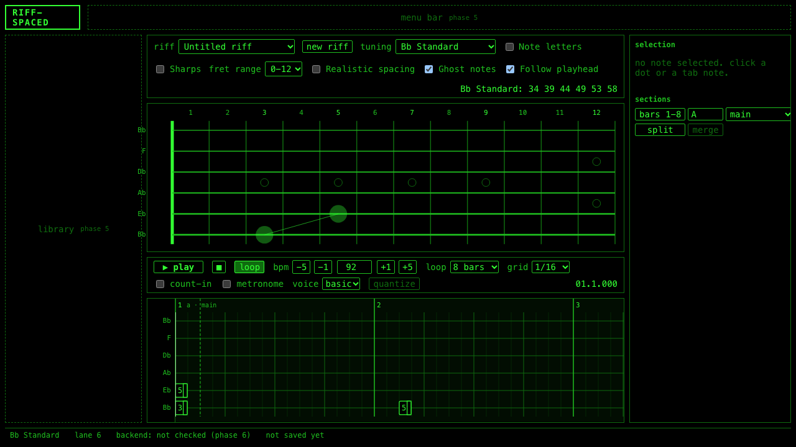

Start with File > New riff, or edit a demo. Then:

- **Click a fret** on the fretboard. A note of one grid step appears at the edit cursor on that string. Clicking another fret on the same string replaces it.
- **Type a fret number.** Up and Down pick the active lane (the status bar shows `lane 6`), then type digits. Two digits within 400 ms make a two-digit fret, so `1` `2` is fret 12. Enter commits early, Esc cancels.
- **Shift-click** a fret to add a second note at the same moment as a dyad. 6:3 then Shift 5:5 in Bb Standard is a Db power chord. The two notes share a chord id, so they move together when dragged.
- **Move the cursor** with Left and Right (one grid step), Shift+Left and Shift+Right (one bar), or click in the ruler.

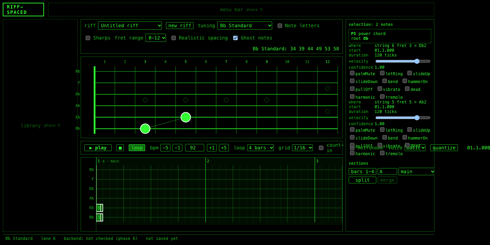

Select two notes that start together and the inspector names the interval: `P5 power chord, root Db`, or `P4 inverted power chord, root Db, inverted (root on top)`. The full table is m2, M2, m3, M3, P4, TT, P5, m6, M6, m7, M7 and unison/octave.

**Durations and the grid.** The grid is 1/4, 1/8, 1/16, 1/8T or 1/16T, from the transport or with `[` and `]`. New notes are one grid step long. Drag a note's right edge to stretch it, drag the body to move it in time (snaps to the grid) or across lanes (same fret, new string, so a new pitch; hold Alt to keep the pitch and let the app refinger it). Edit > Quantize selection to grid snaps starts and lengths.

**Selection and clipboard.** Click selects, Shift-click adds, drag on empty space for a marquee, Ctrl/Cmd+A selects all. Ctrl/Cmd+C, X, V copy, cut and paste at the cursor; Ctrl/Cmd+D duplicates one grid step later. Delete or Backspace removes. Pasted notes get a fresh chord id, so a paste is its own chord.

**Techniques and velocity** are checkboxes and a slider in the inspector: palm mute, let ring, slide up, slide down, bend, hammer-on, pull-off, vibrato, dead, harmonic, tremolo. Playback only hears palm mute, let ring and dead; the rest are stored, and hammer-ons, pull-offs and slides also go into the MusicXML export.

**Sections and loop length.** A riff is 4, 8, 12 or 16 bars (the loop selector in the transport). Growing it extends the last section. Shrinking would delete notes past the new end, so a dialog tells you how many and asks first.

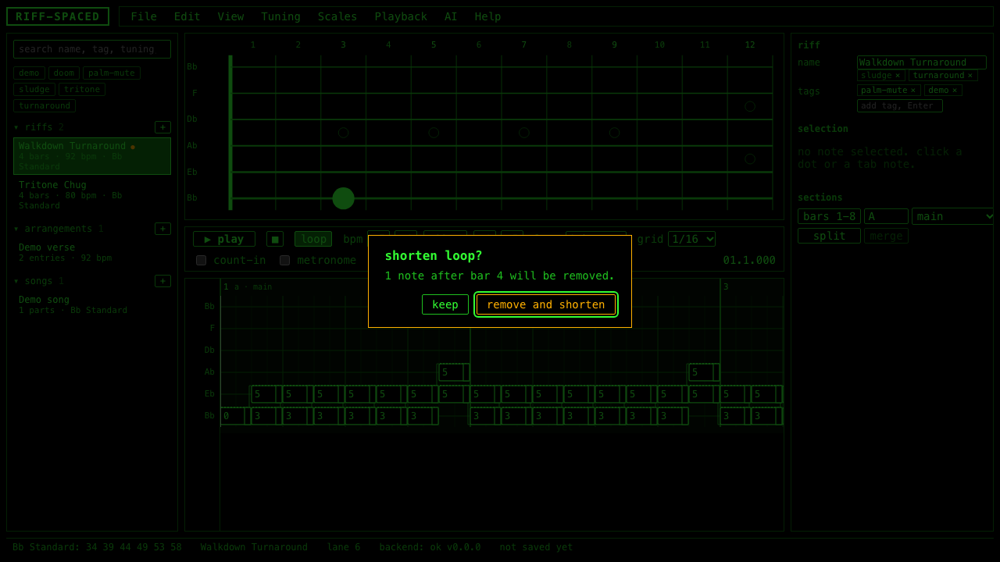

Sections live in the inspector: label, bar range, kind (main, variation, turnaround and so on), split in two, merge with the next. Clicking a section's label moves the cursor there and solos it for playback.

**Undo.** Every edit is one undo step, including drags, pastes, retunes and accepted AI suggestions. Ctrl/Cmd+Z, Ctrl/Cmd+Shift+Z or Ctrl/Cmd+Y; the Edit menu names what it will undo.

**Autosave.** Half a second after any change the whole library is written to the browser's local storage and the status bar updates `saved`. Reloading lands you on the same riff.

## 5. Play it


Space plays and stops from the edit cursor. The first press may show `tap to enable audio` in the transport; browsers require a click before sound.

- **Loop** (L, or the transport button) repeats the riff, or the soloed section if one is set (Playback > Solo section, or click a section label in the inspector). Off, it plays once and stops.
- **Count-in** gives one bar of clicks before the start. **Metronome** clicks through, louder on beat one.
- **bpm** 30 to 300, typed or nudged; `-` and `=` change it by one, even while playing.
- **Voice.** Basic is a clean-ish synth (saw and square through a lowpass). Heavy adds a sub octave and a crude distortion stage, closer to the intended sound. Neither is an amp sim; samples are on the backlog.
- **Split view** (View > Split view) replaces the fretboard with four mini necks, each showing a quarter of the loop with all of its notes as dots, the active quarter outlined while playing.

Each sounding note flashes bright on the fretboard and the playhead moves in the tab lanes. Both are driven from the audio clock, so what you see is what you hear to within a frame; the status bar reports the measured gap as `sync ±N ms`.

## 6. Tunings

The Tuning menu has three preset groups.

| Standard | Drop | Seven string |
|---|---|---|
| E, Eb, D, C#, C, B, **Bb**, A Standard | Drop D, C#, C, B, Bb, A, Ab | B Standard 7 |

Drop tunings are the matching standard tuning with the lowest string down a whole step; Drop Ab is Bb Standard with a low Ab1.

**Retune mode** decides what happens to the notes when the tuning changes. Tuning > Retune mode toggles it and the label shows the current one.

- **Keep shapes** (the default): frets and strings stay, pitches move with the strings. One click lowers or raises the whole riff. Nothing can become unplayable.
- **Keep pitches**: the sounding notes stay, the app refingers every note on the new strings, keeping the hand where it was when it can. A pitch no string reaches is flagged unplayable.

**Custom retune...** asks for a semitone change per string from the current tuning and applies it in the current retune mode. Strings must still rise from low to high within a sensible range or the dialog refuses.

**Transpose...** (Edit menu) shifts every pitch by -12 to 12 semitones on the same tuning and refingers. It previews first; if any note would have no fingering it says how many and asks before applying.

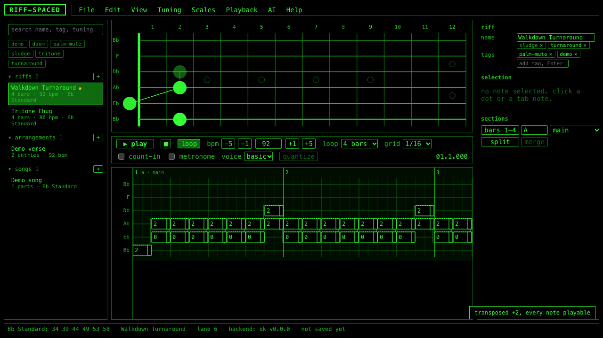

**Find easier tuning...** tries every preset with the same string count and every single-string change of one or two semitones, refingers your riff on each with the pitches kept, and lists the five best. Lower score is easier: 2 per unreachable note, 0.5 per fret of stretch, 0.2 per fret the hand moves. Your current tuning is always in the list for comparison. Preview shows the refingered riff on the fretboard without changing anything (the status bar says `previewing: ...`), Apply retunes keeping pitches as one undo step.

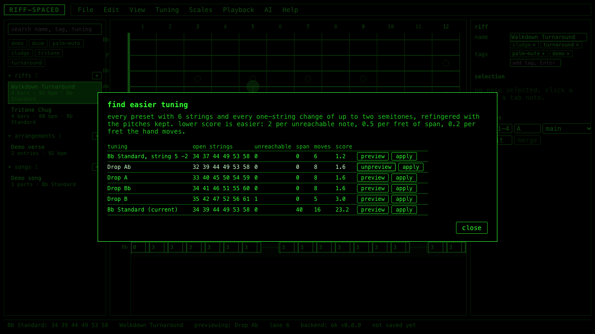

**Amber notes.** A hollow amber dot (and an amber box in the tab) is a note flagged unplayable: after a transpose or a keep-pitches retune, no string and fret within reach produces that pitch. It is kept, so nothing is lost, but it is silent in playback and left out of MIDI and MusicXML exports. Transpose back, retune, or move it by hand. A filled amber dot is a different thing: a low-confidence note from an audio import (section 8).

Arrangements have one more rule: every riff in an arrangement must share its tuning. If you add a riff in another tuning the app refuses and tells you to retune it with keep pitches first.

## 7. Save, load, export

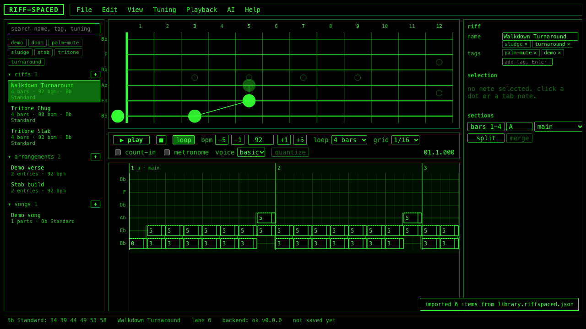

**The library is the home of everything.** Riffs, arrangements and songs are autosaved to the browser, and File > Open from library switches between them. Arrangements (File > New arrangement) sequence riffs by reference with repeats and a transpose per entry; songs sequence arrangements. Edit a riff and every arrangement using it changes too.

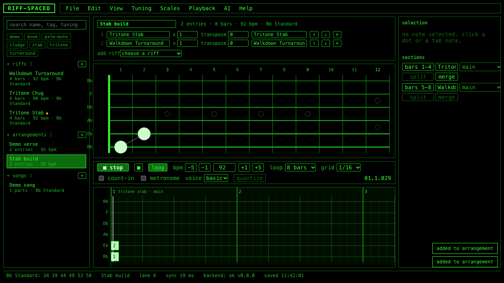

**Files.** File > Open... (Ctrl/Cmd+O) reads a `.riff.json`, `.arr.json`, `.song.json` or a whole `.riffspaced.json` library. File > Save (Ctrl/Cmd+S) writes the open item; in Chrome it remembers the file and overwrites it next time, elsewhere it downloads. Save as... always asks. File > Recent lists the last ten.

**Whole library.** File > Export library writes everything to one `.riffspaced.json`, your backup. File > Import library... merges one in; when ids collide it asks once whether to replace your copies or keep both (the incoming ones get new ids and `(imported)` after their names).

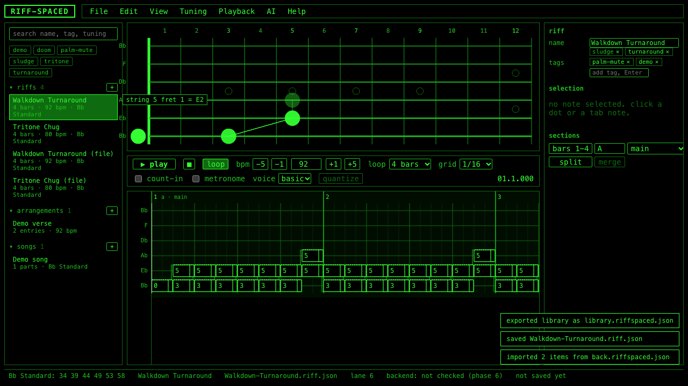

**Exports** are under File > Export.

- **Text tab**: ASCII tab, one character per sixteenth, string 1 on top, `p` under palm-muted columns, four bars per system. Edit > Copy as text tab puts the same thing on the clipboard.
- **MIDI...**: a standard MIDI file at the riff's own tick resolution, program 30 (distortion guitar). The dialog offers **one channel per string**, which lets a DAW route each string to its own instrument. Palm-muted notes come out half as long; other techniques are not written.
- **MusicXML**: a tab-staff score with string and fret on every note, palm mute as a technical marking, ties across bar lines, for MuseScore or Guitar Pro. Open one and tell the project how it looks; it has only been checked against the XML spec.
- **WAV...**: renders the riff offline through the Basic or Heavy voice for 1 to 8 loop passes and downloads a 16-bit WAV. No microphone or playback involved, so it is exact.
- PDF is on the backlog and shows as disabled.

## 8. Import a recording

Needs the backend. File > Import from audio... opens the dialog; the item is disabled while the backend is unreachable.

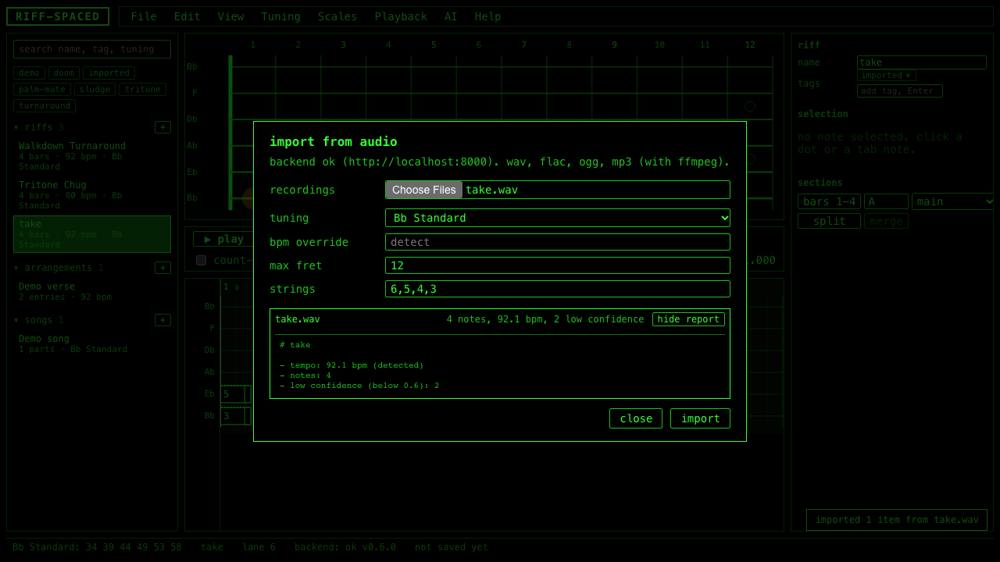

Pick one or more recordings (wav, flac, ogg, aiff; mp3 and m4a if ffmpeg is installed next to the backend). Then:

- **tuning**: the tuning you were in. It starts at the current riff's tuning. The analyzer only looks for pitches that exist on that neck, so a wrong tuning gives wrong frets.
- **bpm override**: leave blank to let it detect the tempo, or type one if you know it.
- **max fret** and **strings**: how far up the neck and which strings to consider. The defaults, fret 12 and strings 6,5,4,3, match how the owner plays.

Click import. Each file is analyzed in turn, lands in the library as a riff tagged `imported`, and its line shows `N notes, X bpm, M low confidence` with a report you can unfold.

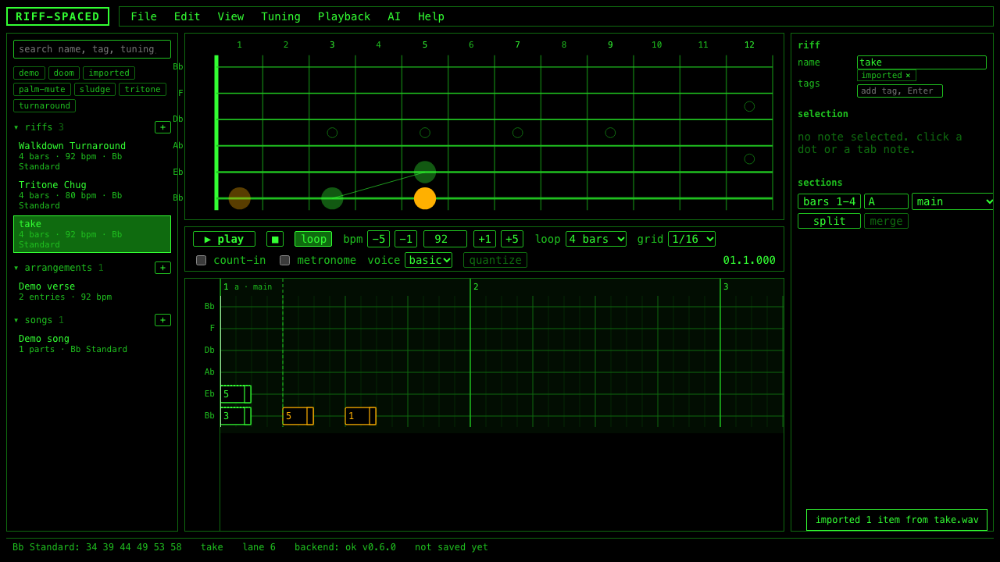

**Confidence colors.** Every imported note carries a confidence from 0 to 1. Notes below 0.6 are drawn as filled amber dots on the fretboard and amber boxes in the tab, and the inspector shows the number. Amber means "check this one"; it plays normally. Fix or delete and the note becomes an ordinary green note.

**Where this stands.** The analyzer is tuned against synthesized test signals, where it does well. The first real recordings (three phone takes) have been through it and the results are an open experiment, written up in `docs/ANALYSIS_METHOD.md` and `docs/benchmarks/real-audio-notes.md`: dyad identification was weak, no palm muting was detected, and the recordings may not have been in the tuning assumed. Expect to edit an import, not play it as is. Clean recordings with one riff, a steady tempo and a known tuning give it the best chance.

**Another tool instead.** The `outboard-guidance/` folder at the repo root has a guide, the riff schema and an example for transcribing a recording with any other program or language model. Put the resulting `.riff.json` files in `injest-riff-JSON/`, check them with `python -m riffspaced.check_riffs ../injest-riff-JSON` from `backend/`, and open them with File > Open.

## 9. Ask the AI

Needs the backend with `ANTHROPIC_API_KEY` set, or `RIFFSPACED_AI_FAKE=1` for the built-in fake. The fake derives its answers from the riff with the same music arithmetic the app uses, so the whole flow can be tried without a key; its answers say `model: fake`. Every AI item is disabled with the reason as a tooltip until the backend is up, configured, and a riff is open.

The audio never goes to the model. The backend turns the riff into note events and facts (pitches, names, intervals, positions), the model reasons over those, and the backend validates and repairs the answer before you see it. Every request carries the owner's style directive from SPEC.md section 9.1 word for word: dissonance is intentional, open lines stay open, the turnaround feel stays inside the heavy style. The model is told not to correct what you wrote.

**Analyze riff** fills the analysis panel in the inspector: one chip per dyad with its label and root (click a chip to select those notes and move the cursor; a dashed chip was computed by the backend because the model skipped it), the key center and mode guess, whether a turnaround was detected, the chromatic devices it noticed, a summary, and any warnings. The analysis belongs to that riff and goes away when you open another.

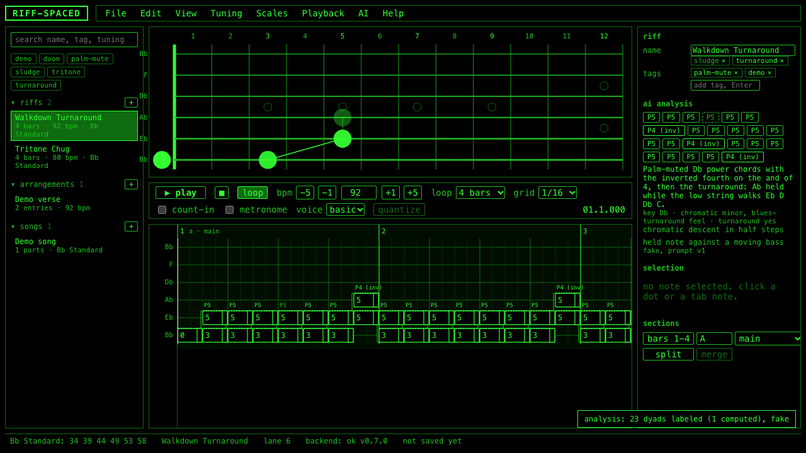

With **View > Dyad labels** on, the same labels are drawn above the chord brackets in the tab.

**Suggestions** come from the rest of the menu: Suggest variations, Suggest counter riff, Suggest counter melody, Switch up the rhythm, Simplify, Embellish, New riff in this style, Alternate fingerings, Alternate tunings. Each opens the suggestions drawer on the right (View > Suggestions drawer) and adds cards: a name, the rationale, playing notes, anything the backend had to repair, a small fretboard with every position used, and four buttons.

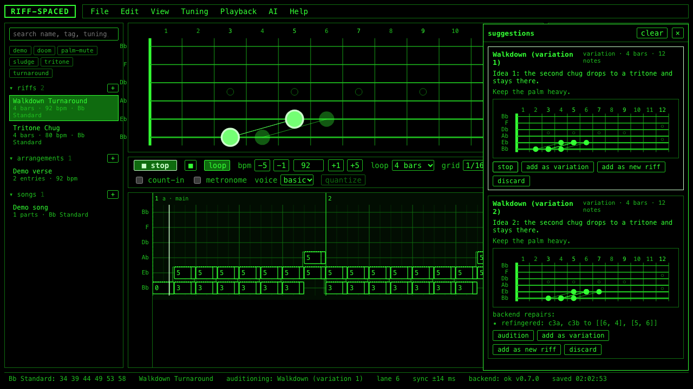

- **audition** plays the suggestion through the current voice while your riff stays as it is; the fretboard follows the suggestion and the status bar says `auditioning: ...`. Stop with the card, Space, or the transport.
- **add as variation** appends it to the open riff as a new `variation` section. Only for suggestions in the same tuning (the button says so otherwise).
- **add as new riff** copies it into the library as its own riff tagged `ai`, leaving the open riff alone.
- **discard** removes the card.

Asking for the same kind again sends the cards already shown as things to avoid, so you get something different. Alternate tunings proposes other tunings with the riff refingered for each.

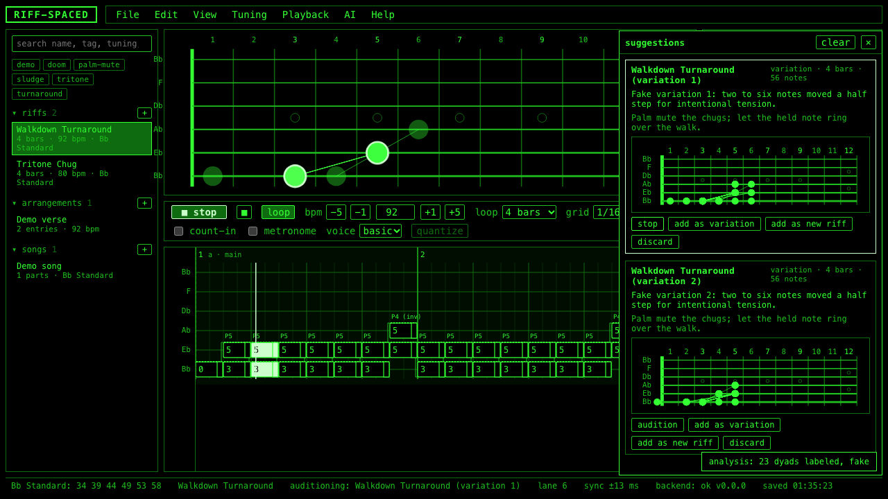

Nothing changes your riff without a click, and every accept is one undo step. AI > Settings... sets the backend URL and an optional model name; the model name is only honored if the backend was started with `RIFFSPACED_ALLOW_MODEL_OVERRIDE=1`.

## 10. Shortcuts

Help > Keyboard shortcuts shows this table in the app. Shortcuts do not fire while you are typing in a text box.

| Keys | Action |
|---|---|
| Space | play / stop |
| L | loop on / off |
| Left / Right | move the edit cursor one grid step |
| Shift+Left / Shift+Right | move the edit cursor one bar |
| Up / Down | change the active string lane |
| 0-9 | type a fret number for the active lane at the cursor (two digits within 400 ms) |
| Enter | commit the typed fret now |
| Esc | cancel the typed fret / clear the selection |
| Delete / Backspace | remove the selected notes |
| Ctrl/Cmd+A | select all notes |
| Ctrl/Cmd+Z | undo |
| Ctrl/Cmd+Shift+Z | redo |
| Ctrl/Cmd+C / X / V | copy / cut / paste at the cursor |
| Ctrl/Cmd+D | duplicate the selection one grid step later |
| Ctrl/Cmd+S | save (Shift: save as) |
| Ctrl/Cmd+O | open a file |
| [ / ] | coarser / finer grid |
| - / = | tempo down / up by 1 |
| Tab | toggle note letters |

Ctrl/Cmd+Y also redoes. Ctrl/Cmd + mouse wheel zooms the tab lanes. In an arrangement or song view only the transport keys work; editing happens in the riff.

## 11. If something looks wrong

**`backend: unreachable` in the status bar.** The frontend is fine; only Import from audio and the AI menu are off. Start the backend (section 2) and wait up to 15 seconds for the next poll, or check the URL in AI > Settings... Hover the status for the error.

**AI menu grayed with `ANTHROPIC_API_KEY not set`.** The backend is up but has no key. Set one in `backend/.env`, or set `RIFFSPACED_AI_FAKE=1` there to use the fake, and restart it.

**Amber notes.** Hollow amber is unplayable after a transpose or retune, silent until you fix it (section 6). Filled amber is a low-confidence note from an import, audible but worth checking (section 8).

**`saved library could not be read` in amber in the status bar.** The autosaved library in the browser did not validate, so it was moved aside under a timestamped key in local storage and the demo library loaded. Nothing was deleted. If you have a File > Export library backup, import it.

**Playback is silent.** Look for `tap to enable audio` in the transport and click anywhere; browsers block sound until the page has been clicked. `audio unavailable in this browser` means no Web Audio.

**Start over.** Open the app with `?demo=1` on the address (for example http://localhost:5173/?demo=1). This throws away the saved library and preferences and loads the demo riffs. Export your library first if there is anything in it you want.

**CRT look.** View > CRT toggles the scanline overlay. It is off by default and remembered between visits.

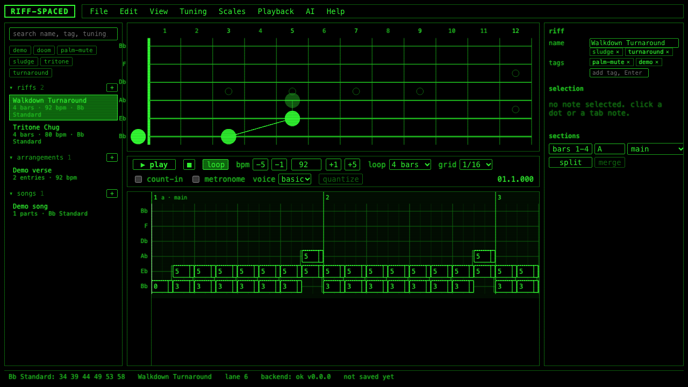
